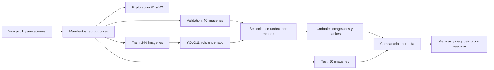

# Arquitectura y alcance

El problema es clasificación binaria por imagen: `normal` frente a `anomaly` en VisA pcb1. La clase positiva es anomalía. YOLO11n-cls es un clasificador, y no produce cajas ni máscaras. Decisions API responde al predicado visual `visible_defect`; ninguno de los dos métodos certifica funcionamiento eléctrico.

En `src/decisions/client.py`, la imagen JPEG/PNG/WebP se convierte en data URL; el cliente envía contexto y una pregunta `predicate` a `client.decisions.create(model="gpt-6-luna", ...)`. Extrae una probabilidad, no una explicación ni una localización. La [referencia oficial de Decisions API](https://developers.openai.com/api/reference/resources/decisions/methods/create) describe este contrato.

`run_benchmark_v4.py` separa validation/test y conserva respuestas crudas, latencia, estado, modelo y timestamp. El identificador de checkpoint es SHA-256 de la ruta, truncado a 16 caracteres. Los éxitos se reutilizan y los errores pueden reintentarse. Ese caché histórico no vincula la identidad del prompt o los bytes de la imagen: para experimentos nuevos se requieren nuevos directorios/versiones y hashes. Los hashes agregados hoy documentan el estado actual; no prueban retroactivamente el texto exacto enviado en todas las llamadas anteriores.

Para YOLO, `prepare_yolo_dataset.py` copia cada imagen del manifest a `train/val/test` y `normal/anomaly`. `train_yolo.py` ajusta los pesos preentrenados; `best.pt` se selecciona con validación. `offline_audit_compare.py` comprueba esa selección con inferencia de validación, congela el umbral y compara test con los CSV de API sin importar el cliente ni cargar `.env`.

No hay interfaz de producción, cola de revisión humana ni reglas PASS/MANUAL_REVIEW/REJECT implementadas en la evidencia revisada. Son próximos pasos. Las carpetas `notebooks/` y `scr/` no constituyen evidencia de resultados ejecutados.
